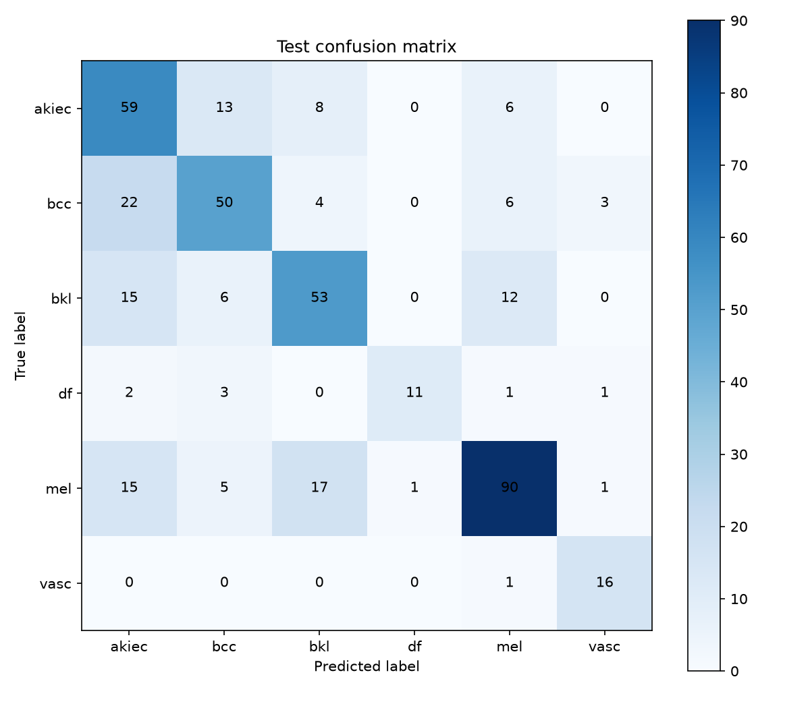

# Skin Disease Detection

A research prototype for classifying dermoscopic skin-lesion images into six categories. The project includes training scripts, single-image prediction, and a Streamlit interface.

> **Important:** This software is for research and educational use only. It is not a medical device and must not be used to diagnose, treat, or rule out any condition. Consult a qualified healthcare professional for medical advice.

## Results

The figure below is the confusion matrix from a recorded ResNet18 baseline test run. It summarizes predictions across 421 held-out images; results will vary with the dataset, split, and training configuration.

| Evaluation metric | Recorded result |
| --- | ---: |
| Balanced accuracy | 0.690 |
| Macro F1-score | 0.692 |
| Test images | 421 |



Rows show the true class and columns show the predicted class. Counts on the diagonal are correct predictions.

## Project contents

- `train_model.py` — train and evaluate the ResNet18 baseline.
- `train_ensemble.py` — train a ResNet18 and EfficientNet-B0 probability ensemble.
- `predict.py` — run prediction for one image using a trained ResNet18 checkpoint.
- `app.py` — launch the Streamlit image interface.
- `assets/confusion_matrix.png` — confusion matrix from the recorded baseline evaluation.

Dataset files, trained checkpoints, and generated training artifacts are intentionally not included.

## Requirements and installation

Python 3.10 or newer is recommended. Create a virtual environment and install the project dependencies:

```bash
python3 -m venv .venv
source .venv/bin/activate
python -m pip install --upgrade pip
python -m pip install -r requirements.txt
```

The first training run downloads pretrained model weights. On Apple Silicon, PyTorch may use the MPS accelerator when available.

## Dataset

Obtain an appropriate skin-lesion dataset and confirm its terms of use before using it. Place the metadata CSV and matching images in this layout:

```text
ISIC-images/
├── metadata.csv
└── Images/
    ├── <image_id>.jpg
    └── ...
```

The training scripts use `ISIC-images/` by default. To use a different directory, pass `--data-dir`.

## Train and evaluate

Train the baseline model:

```bash
python train_model.py --epochs 10
```

The script validates labels, removes repeated image IDs, keeps images from the same lesion together, creates stratified train/validation/test splits, and trains with class-weighted loss. It calibrates the malignant-risk threshold on the validation split and evaluates on the held-out test split.

Train the probability ensemble instead:

```bash
python train_ensemble.py --epochs 10 --batch-size 32
```

Training outputs are written to `artifacts/`, including model checkpoints, evaluation metrics, split CSVs, and a generated confusion matrix. These files are ignored by Git.

## Predict an image

After training the baseline:

```bash
python predict.py ISIC-images/Images/<image_id>.jpg
```

The predictor loads `artifacts/best_model.pt` by default. Pass `--model` to select another checkpoint.

The supported classes are `akiec`, `bcc`, `bkl`, `df`, `mel`, and `vasc`.

## Run the web interface

```bash
streamlit run app.py
```

Open the local URL printed by Streamlit. The interface accepts an image upload or a camera capture (with browser permission). When available, it prefers `artifacts/ensemble_model.pt` and otherwise uses `artifacts/best_model.pt`. It displays an estimated risk grouping and may warn about small or low-contrast images; these outputs are not a diagnosis.
