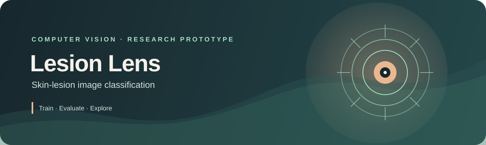

<p align="center">
  
</p>

<p align="center">
  <a href="https://github.com/haidrerDroid/lesion-classifier/actions/workflows/tests.yml"></a>
  
  
  
</p>

<p align="center">
  A research prototype for training, evaluating, and exploring six-class skin-lesion image classifiers.
</p>

> **Research and education only.** This project is not a medical device and must not be used to diagnose, treat, or rule out any condition. Its predictions can be wrong; consult a qualified healthcare professional for medical advice.

## At a glance

| | |
| --- | --- |
| **Task** | Classify dermoscopic images into six lesion categories |
| **Models** | ResNet18 baseline and ResNet18 + EfficientNet-B0 ensemble |
| **Interface** | Local Streamlit app for image upload and camera capture |
| **Data and weights** | Not included; provide a dataset and train checkpoints locally |

### Navigate

[Results](#recorded-baseline-results) · [Features](#what-it-includes) · [Setup](#get-started) · [Dataset](#2-prepare-a-dataset) · [Training](#3-train-a-model) · [Prediction](#predict-one-image) · [Web app](#launch-the-web-interface) · [Development](#development)

## Recorded baseline results

The confusion matrix below is from a recorded ResNet18 baseline test run on 421 held-out images. Results depend on the dataset, split, and training configuration; this result is not a guarantee of future performance.

<p align="center">
  
</p>

<p align="center">
  <strong>Balanced accuracy: 0.690</strong>
  &nbsp; · &nbsp;
  <strong>Macro F1-score: 0.692</strong>
  &nbsp; · &nbsp;
  <strong>Held-out images: 421</strong>
</p>

Rows represent true classes; columns represent predicted classes. Diagonal cells are correct predictions. These are saved baseline results, not results generated during repository setup.

## What it includes

| File | Purpose |
| --- | --- |
| [`train_model.py`](train_model.py) | Train and evaluate a ResNet18 baseline |
| [`train_ensemble.py`](train_ensemble.py) | Train a ResNet18 + EfficientNet-B0 probability ensemble |
| [`predict.py`](predict.py) | Predict classes for one image using a trained baseline checkpoint |
| [`app.py`](app.py) | Launch the Streamlit image interface |
| [`assets/`](assets/) | Repository banner and recorded baseline confusion matrix |
| [`tests/`](tests/) | Unit tests for data handling, lesion-safe splits, metrics, and plots |

## Get started

### 1. Install dependencies

Python 3.10 or newer is recommended.

```bash
python3 -m venv .venv
source .venv/bin/activate
python -m pip install --upgrade pip
python -m pip install -r requirements.txt
```

### 2. Prepare a dataset

Dataset files are intentionally not included. Obtain an appropriate dataset and review its terms before use. The training scripts expect:

```text
ISIC-images/
├── metadata.csv
└── Images/
    ├── <image_id>.jpg
    └── ...
```

The metadata must include `image_id`, `dx`, and `lesion_id` columns. Supported image extensions are `.jpg`, `.jpeg`, and `.png`. To use another directory, pass `--data-dir`.

### 3. Train a model

Train the baseline:

```bash
python train_model.py --epochs 10
```

Or train the probability ensemble:

```bash
python train_ensemble.py --epochs 10 --batch-size 32
```

Training outputs—including model weights, split files, metrics, and generated plots—are written under `artifacts/` and are ignored by Git. The first run may download pretrained weights. On Apple Silicon, PyTorch uses MPS when available.

## Predict one image

After training the baseline, run:

```bash
python predict.py ISIC-images/Images/<image_id>.jpg
```

The predictor loads `artifacts/best_model.pt` by default; use `--model` to specify another baseline checkpoint. The six output labels are `akiec`, `bcc`, `bkl`, `df`, `mel`, and `vasc`.

## Launch the web interface

```bash
streamlit run app.py
```

Open the local URL printed by Streamlit. The interface accepts an image upload or camera capture (with browser permission). It uses `artifacts/ensemble_model.pt` when present and otherwise falls back to `artifacts/best_model.pt`. A checkpoint must be trained before using the app.

## Development

Install development tools and run the same checks as GitHub Actions:

```bash
python -m pip install -r requirements-dev.txt
ruff check --select E4,E7,E9,F .
python -m pytest
```

GitHub Actions runs linting and tests on Python 3.10 and 3.12 for pushes to `main`, pull requests, and manual runs.
